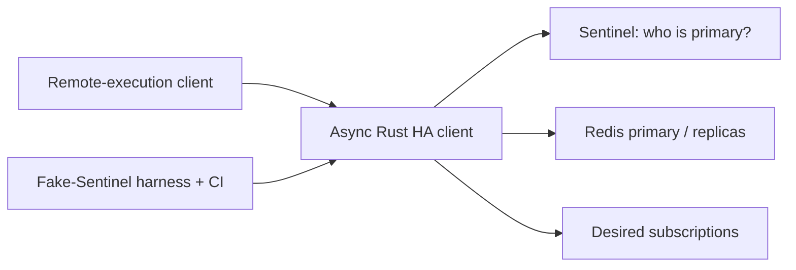

# High-Availability Distributed Store with Automated Failover Recovery

Rust • Redis Sentinel (modelled) • Raft types • CI/CD

**Core message: a Redis failover does not guarantee that the application
client has recovered.** Sentinel coordinates which Redis instance is
primary. It does not replace the client's connections, and it does not
restore the client's subscriptions. This project makes recovery explicit,
guarded, and testable.

Built from the TCC interview playbook (`TCC_Distributed_Store_Interview_Cracker.pdf`).
This is a clean-room re-implementation of the behaviour described there —
not a copy of any production codebase, and not a claim about production
metrics. What is claimed here is exactly what the tests prove, below.

## The 90-second story

> A high-availability storage backend for a distributed remote-execution
> platform. Redis Sentinel failover could happen, but the application's
> write paths could remain stuck because client-side recovery was
> incomplete  writes stayed unavailable even after the storage layer
> had failed over. The work focused on the async Rust storage module:
> failure detection across three write paths, UUID-guarded reconnect
> deduplication, and pub/sub resubscription, validated by a
> fake-Sentinel failover harness in CI. Separately, a consensus-layer
> type refactor removed a compiler-level circular dependency that
> blocked the Raft API.

## Architecture



| Layer | Responsibility | What can go wrong |
|---|---|---|
| Remote-execution platform | Issues requests / state updates through storage | Writes blocked if the client stays in a failed state |
| Async Rust storage client | Write paths, failure detection, reconnect coordination, subscription restoration | Overlapping recovery; a reconnect that does not restore pub/sub |
| Redis primary/replicas + Sentinel | Store state; Sentinel coordinates primary failover | Primary changes; old client connections are unusable |
| Fake-Sentinel harness + CI | Injects failures, reruns them deterministically | A fake cannot model every real Redis / network timing |

### Recovery sequence (every time)

1. **Failure observed**  a write path reports a connection failure.
2. **Recovery coordinated**  a UUID guard admits exactly one recovery attempt; concurrent callers are deduplicated.
3. **Endpoint recovered**  Sentinel names the current primary.
4. **Connection recovered**  the client reconnects to that primary.
5. **Pub/sub restored**  every desired subscription is re-established, idempotently, *before* the client reports healthy.
6. **Writes resume**  idempotent writes retry once with their original operation id; the backend's op log makes that retry a no-op if the first attempt already committed.

### The three write paths

- **Single**  `put(key, value)`
- **Batch**  `put_batch(entries)` under one operation id
- **Conditional**  `compare_and_swap(key, expected, new)`; the condition is re-evaluated on retry, so a stale condition still fails instead of silently overwriting

### What is *not* done, on purpose

- **Ambiguous writes are not blindly retried.** If a connection drops
  after a write is sent, the client may not know whether Redis committed
  it. `put_without_idempotency` surfaces `AmbiguousWrite` instead of
  retrying; the caller reconciles or retries with an operation id.
- **Sentinel and Raft are not interchangeable.** Sentinel coordinates
  Redis failover; Raft is a consensus algorithm. The Raft work here is a
  separate type-system refactor (see below), not a Redis reconnect mechanism.
- **AI is not in the recovery path.** The critical path stays
  deterministic: explicit state machine, bounded retries, idempotent
  operations, invariant tests. An AI assistant could summarise logs for
  an on-call engineer (read-only, cited, human-approved)  it must not
  decide whether a write is safe to retry.

### Raft type refactor

Previously, the Raft API types and Raft state types depended on each
other  a compiler-level cycle that blocked the API. The fix is a
boundary: shared types live in the leaf crate `consensus_types`, and
`raft_api` and `raft_state` each depend *only* on it. Neither depends
on the other, so no cycle can form. See
`crates/consensus_types/src/lib.rs` for the explanation in code.

## Run it

```bash
cargo test --workspace
cargo run -p ha_store --example failover_demo
```

## What the tests prove (verified locally, 2026-10-27)

**17 tests pass, 0 fail**  10 fake-Sentinel failover scenarios in
`crates/ha_store/tests/failover.rs`, plus 7 unit tests (guard, backoff,
metrics, consensus types, Raft API, Raft state):

1. Single write recovers after failover
2. Batch write recovers after failover
3. Conditional write recovers after failover, condition still honoured
4. 10 concurrent failures trigger exactly 1 recovery (9 deduplicated)
5. Subscriptions restored after reconnect, without duplicates, across repeated failovers
6. Network partition exhausts bounded retries (`RetryExhausted`), then a healed cluster recovers  proving the guard clears on failure
7. Delayed reconnect still recovers, latency recorded (≥ the injected delay)
8. Dropped connection mid-write retries exactly once via operation id (1 applied operation)
9. Ambiguous write is *not* blindly retried, and launches no recovery
10. Repeated failovers each get a fresh recovery UUID

That proves these scenarios behave as specified in this harness. It
does **not** prove production availability, a recovery-time SLA, or
that a real Redis/Sentinel cluster behaves identically  that would
need a real-cluster integration suite and operational metrics
(recovery success rate, p50/p95/p99 recovery latency), which are the
named next steps, not claims made here.

## Trade-offs

| Decision | Helps | Cost / risk |
|---|---|---|
| UUID-guarded recovery | No duplicate recovery work from clustered failures | A guard that never clears would suppress legitimate later recovery  hence `finish()` on every exit path, tested |
| Pub/sub resubscription | Restores message flow after connection recreation | Must track desired subscriptions and resubscribe idempotently |
| Fake-Sentinel tests | Fast, deterministic reproduction in CI | Less realistic than a real cluster  pair with a smaller real-cluster suite |
| Bounded backoff + jitter | No infinite retry storms; clients don't all retry at once | A genuinely long outage still ends in `RetryExhausted` and needs operator attention |
| Cross-crate type refactor | Removes the compile cycle blocking the Raft API | Wide change surface in a real codebase  needs compile checks, tests, review |

## Layout

```text
crates/ha_store/          # client, guard, state machine, fake harness
  src/client.rs           # HaStoreClient: 3 write paths + recover()
  src/guard.rs            # RecoveryGuard (UUID deduplication)
  src/backend.rs          # StoreBackend / Sentinel traits + fakes
  src/state.rs            # ClientState, WritePath, Metrics, Backoff
  tests/failover.rs       # the 10 failover scenarios
  examples/failover_demo.rs
crates/consensus_types/   # shared Raft types (the refactor boundary)
crates/raft_api/          # Raft API, depends only on consensus_types
crates/raft_state/        # Raft state, depends only on consensus_types
.github/workflows/ci.yml  # fmt + clippy + cargo test
```


